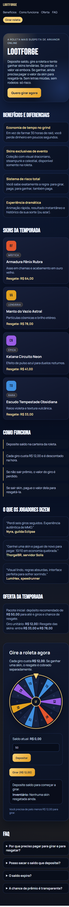
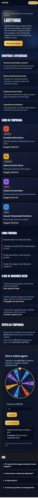
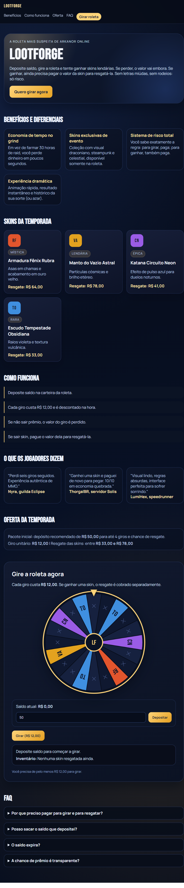
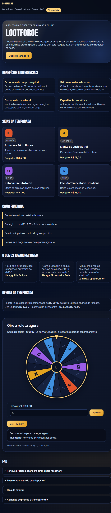
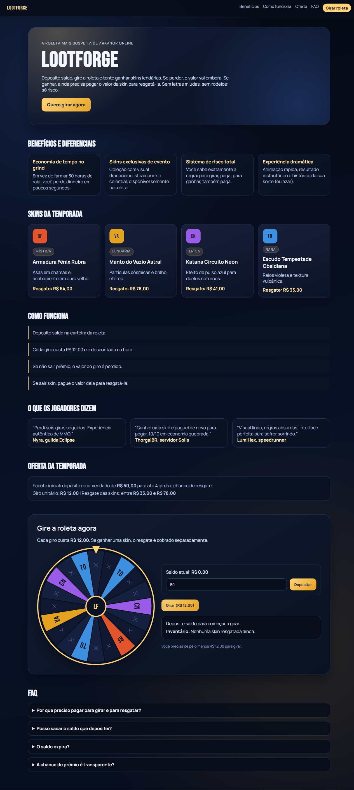
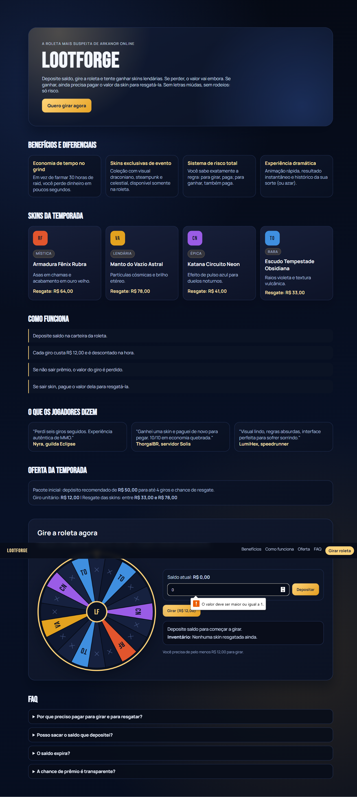
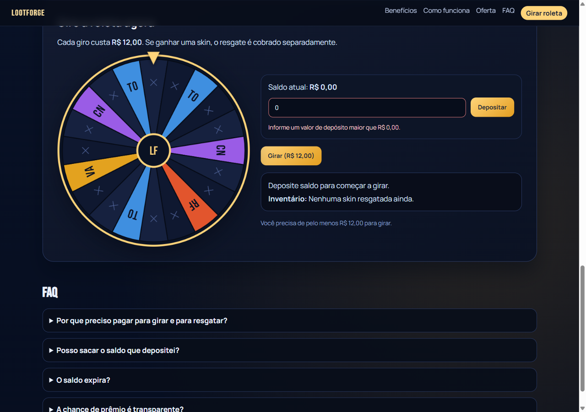
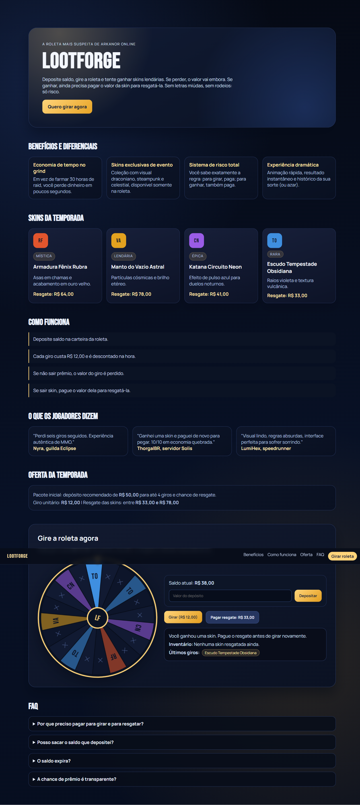
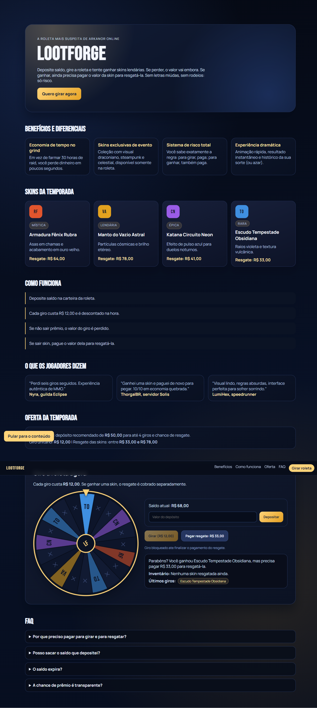
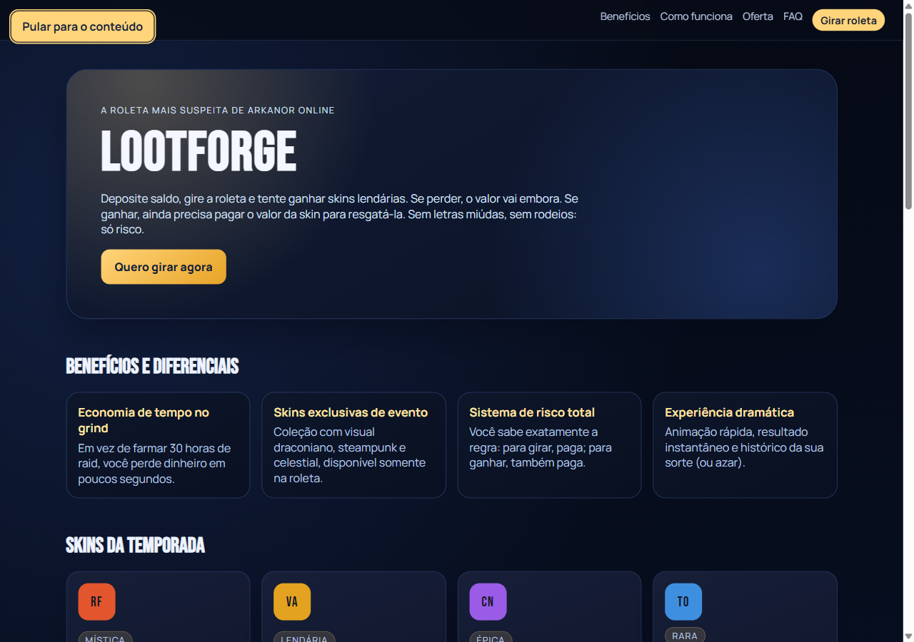

# Relato breve - Atividade 02

## 1. O que foi analisado e melhorado

Analisamos a landing page do LootForge com foco em três frentes: funcionamento da roleta (depositar, girar e pagar resgate), responsividade (375px, 768px e 1280px) e acessibilidade (estrutura semântica, foco por teclado e feedback para erros).

| Problema | Severidade | Correção aplicada | Arquivos alterados |
| --- | --- | --- | --- |
| Depósito inválido sem feedback visível | Alto | Adicionamos validação explícita para valor vazio/zero/negativo, `noValidate` no form para evitar bloqueio nativo e mensagem com `role="alert"` + `aria-invalid`. | `src/features/roulette/ui/RouletteCta.jsx`, `src/features/roulette/ui/RouletteCta.module.css` |
| Botão Girar habilitado com resgate pendente | Médio | Desabilitamos o botão de giro quando existe skin pendente, com explicação via `title`, `aria-describedby` e texto de apoio visível. | `src/features/roulette/ui/RouletteCta.jsx` |
| Header quebrando em 375px | Médio | Criamos layout compacto para mobile estreito (ocultando links secundários e mantendo CTA principal sem quebra ruim). | `src/pages/landing/ui/LandingPage.module.css` |
| Grids com item órfão em 768px | Baixo | Ajustamos breakpoint intermediário para 2 colunas em benefícios e skins. | `src/pages/landing/ui/LandingPage.module.css` |
| Falta de skip link | Baixo (A11y) | Incluímos link "Pular para o conteúdo" com foco visível apontando para o `<main>`. | `src/pages/landing/ui/LandingPage.jsx`, `src/pages/landing/ui/LandingPage.module.css` |
| Extra A11y: foco pouco visível | Extra | Adicionamos `:focus-visible` consistente para links, botões, input e summary. | `src/app/styles/global.css` |
| Extra A11y: redução de movimento | Extra | Adicionamos regra `prefers-reduced-motion` para encurtar animação de giro e remover transições de botões no componente da roleta. | `src/features/roulette/ui/RouletteCta.module.css` |

## 2. MCP utilizado

Utilizamos o **Playwright MCP** para executar os testes no navegador real e gerar evidências em imagem.

Trecho de configuração no OpenCode (`opencode.json`):

```json
{
  "$schema": "https://opencode.ai/config.json",
  "mcp": {
    "playwright": {
      "type": "local",
      "command": [
        "npx",
        "@playwright/mcp@latest"
      ],
      "enabled": true
    }
  }
}
```

## 3. Por que foi escolhido

Escolhemos Playwright MCP porque o fluxo principal do LootForge depende de interações de usuário em sequência (depositar, girar, ganhar/perder e pagar resgate). Só lendo código seria fácil perder comportamentos de estado em tempo real, como mensagens na tela, habilitação/desabilitação de botões e transições entre estados. Com o navegador real, conseguimos validar os fluxos do jeito que o jogador usa de fato, além de testar breakpoints e navegar por teclado na própria interface final.

## 4. Como o MCP contribuiu

O ponto mais importante foi o bug do botão `Girar` habilitado com resgate pendente. Esse problema apareceu na auditoria interativa, quando executamos o fluxo real de jogar (depositar, girar até ganhar uma skin e tentar continuar). Só lendo o código, esse encadeamento de estados era menos óbvio.

Depois de corrigir, rodamos um script de verificação via Playwright para validar objetivamente o estado bloqueado, retornando `spinDisabledWithPending: true`. Além disso, o MCP foi usado para repetir os cenários de roleta, validar navegação por teclado e gerar as capturas antes/depois para comparação visual.

Comparações antes/depois:

### Responsividade

375px  
  


768px  
  


1280px  
  


### Fluxo de depósito inválido

  


### Fluxo com resgate pendente

  


### Skip link visível



## 5. Avaliação crítica

O MCP ajudou de verdade a validar estados dinâmicos da roleta e comportamentos responsivos que não ficam evidentes em revisão estática de código. Também foi útil para confirmar foco por teclado e verificar a árvore de acessibilidade básica.

Limites e pontos que ele não cobriu completamente:

- Não fizemos medição formal de contraste (WCAG) com ferramenta dedicada.
- Não executamos teste com leitor de tela real (NVDA/JAWS/VoiceOver), apenas validação por snapshot e atributos ARIA.
- O sorteio da roleta é aleatório; por isso, os testes de "ganhar skin" exigiram repetição automatizada para chegar ao estado de resgate.

## 6. Como reproduzir

```bash
npm install
npm run dev
```

Com o servidor rodando em `http://localhost:5173`, repetir auditoria manual:

1. Testar depósito inválido (`0`, vazio ou negativo) e conferir mensagem.
2. Testar giro sem saldo.
3. Depositar saldo e girar até gerar prêmio.
4. Com prêmio pendente, confirmar que `Girar` fica desabilitado.
5. Testar resgate sem saldo e depois com saldo.
6. Validar Tab no início para exibir "Pular para o conteúdo".
7. Capturar telas em 375, 768 e 1280.

## Arquivos criados

- `docs/RELATORIO_MCP.md`
- `docs/evidencias/antes/audit-landing-375.png`
- `docs/evidencias/antes/audit-landing-768.png`
- `docs/evidencias/antes/audit-landing-1280.png`
- `docs/evidencias/antes/bug-deposito-invalido-antes.png`
- `docs/evidencias/antes/bug-girar-pendente-antes.png`
- `docs/evidencias/depois/audit-landing-375.png`
- `docs/evidencias/depois/audit-landing-768.png`
- `docs/evidencias/depois/audit-landing-1280.png`
- `docs/evidencias/depois/bug-deposito-invalido-depois.png`
- `docs/evidencias/depois/bug-girar-pendente-depois.png`
- `docs/evidencias/depois/skip-link-visivel-depois.png`

## Resumo dos commits

- `e2e6f66` - Exibe erro de depósito inválido
- `28fbe1a` - Bloqueia giro com resgate pendente
- `6610e89` - Ajusta header para mobile 375px
- `b9e2284` - Reequilibra grids no breakpoint tablet
- `2e337a3` - Inclui skip link e reforços de acessibilidade
- `0521d17` - Adiciona evidências e relatório da auditoria
- `5c0b154` - Corrige acentuação em textos
- `f28cdc0` - Ignora logs MCP e versiona configuração
- `7a64095` - Remove duplicação do erro de depósito
- `d374319` - Atualiza evidências de viewport
